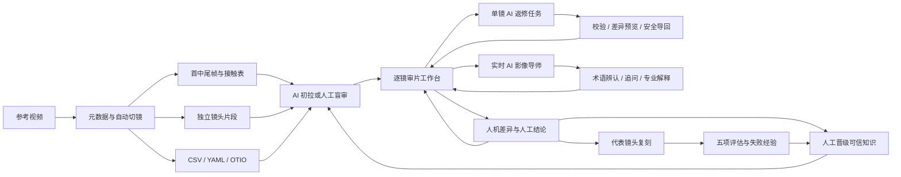

# 拉片超人架构

## 设计目标

系统把“参考视频”转换成四种可以交接的资产：

1. **机械证据**：切点、帧、时码、接触表、独立片段、音频和时间线。
2. **导演判断**：动作因果、力学、摄影机、表演、VFX、声音和前后桥。
3. **生产约束**：重制路线、角色适配、风险、不确定项和验收条件。
4. **学习记录**：AI 初判、人工判断、最终结论、纠错原因、可信知识和复刻结果。

## 总体流程



## 分层结构

### L1：采集层

负责不可争议的机械数据：

- 视频时长、帧率、编码、编码尺寸、显示尺寸、旋转元数据和画幅方向
- 镜头候选边界
- 帧号、时间码和镜头持续时长
- 首帧、中间帧、尾帧、接触表
- 精确切分的视频片段
- OTIO 时间线

### L2：语义层

逐镜描述必须区分：

- **事实**：画面中可以直接观察到的内容
- **判断**：基于连续镜头和物理关系得出的解释
- **待核**：遮挡、运动模糊或素材不足造成的不确定项

### L3：连续性层

每个镜头都要记录：

- 上一镜结束状态
- 本镜动作过程
- 本镜结束状态
- 下一镜开场实际画面
- 姿态、视线、屏幕方向、力向、能量和环境尾迹如何交接

### L4：生产层

把分析结果转换成可执行任务：

- 角色骨架和接触点
- 摄影机参数与运动曲线
- VFX 发生时机和空间层级
- 声音峰值与动作节拍
- 推荐生成路线及失败回退方案
- 每镜验收标准

## 目录结构

```text
拉片超人/
├── src/
│   ├── analyze_reference.py
│   ├── ai_advisor_server.py
│   ├── workbench_server.py
│   ├── video_adapter.py
│   ├── workbench.html
│   ├── learning_project.py
│   ├── build_review_page.py
│   ├── review_app_v4.js
│   └── review_page_template.html
├── templates/
├── examples/demo/
├── tests/
├── outputs/                 # 本地生成，不提交
├── ARCHITECTURE.md
├── README.md
└── requirements.txt
```

## 审片状态

页面把状态保存在浏览器本地：

```text
pending    待审核
issue      存在问题或需返工
confirmed  已人工确认
```

每镜还保存：

- 五项审核清单
- 人工备注
- AI 字段修订补丁
- 最近十次修订历史
- 最近更新时间
- AI 初拉字段、可信度与证据
- 人工草稿、最终结论与纠错原因
- 盲审有效性和学习历史
- 复刻任务、分项评分与失败说明

审核结果可以导出完整学习工程 JSON 并恢复；可信知识和复刻评估可独立导出，阅读交付仍可生成完整 Markdown 或问题镜头清单。

## 本地片库

`src/workbench_server.py` 只监听 `127.0.0.1`，接收浏览器拖入的原始视频并写入受控项目目录。后台先由 `src/video_adapter.py` 用 `ffprobe` 检查容器、编码、音频轨道、`rotate` 标签和 Display Matrix：已经兼容且方向无需烘焙的 MP4/MOV 直接使用，兼容流但容器不合适时重新封装，其他情况生成 H.264/AAC/yuv420p 的 `source/analysis_source.mp4`。带 90°/270° 方向元数据的素材必须转码，把正确方向烘焙进像素并清除旋转标记；转码、抽帧和逐镜片段统一使用方形像素与偶数尺寸。原片副本不会被覆盖，随后才运行机械分析、学习 YAML 生成和审片页面生成。媒体响应支持 HTTP Range，避免整段视频进入内存并允许播放器拖动定位。

## 画幅与证据完整性

- `metadata.json` 和学习工程保存编码宽高、显示宽高、旋转角度、显示比例标签与 `portrait / square / landscape / ultrawide` 方向。
- 抽帧遵循 FFmpeg 自动旋转，并在输出端归一为方形像素。
- 接触表和总览图使用 contain/letterbox；禁止 `ImageOps.fit` 一类会裁掉边缘的填充方式。
- 竖屏监看区提高可用高度，方屏保持接近正方形的审核尺度，超宽视频降低无意义黑场高度。
- 超宽首中尾对照在桌面采用三行；手机端所有对照帧使用自然单列页面滚动，不依赖嵌套固定滚动。
- 页面从项目元数据初始化画幅，并用视频 `loadedmetadata` 与图像自然尺寸进行运行时核对。

片库不承担云端协作，也不会读取项目根目录之外的文件。上传文件名、项目 ID 和静态文件路径都经过边界校验。

项目根目录由以下顺序决定：显式 `--projects-root`、用户配置文件中的网页设置、
`LAPIAN_PROJECTS_ROOT`、仓库内默认 `outputs/projects`。网页切换只替换当前
`ProjectStore`，不迁移旧项目；有上传、格式适配或分析线程时拒绝切换。可选 AI 网关
在未指定固定素材根目录时读取同一用户配置，因此片库切换后帧图路径不会脱节。

## 人机学习层

学习状态不会覆盖 AI 原判断。每个字段分别保存 AI 初判、人工草稿、最终决定、纠错原因、证据和审核模式。只有人工明确执行“沉淀知识”，且原因与证据完整，才会生成可信知识卡。

可信知识通过请求上下文回流到后续 AI 初拉，不代表模型权重已经训练。复刻结果按动作、摄影机、VFX、角色身份和连续性评分，低分项可以成为失败案例。

## 自动诊断层

自动诊断与人工状态相互独立：一个镜头即使尚未人工标记为问题，也可能因为证据不足进入“诊断”筛选。当前规则重点检查：

- 整镜描述是否覆盖起因、过程和结果
- 切点与动作分拍是否包含明确帧号
- 肢体、支撑点和重心是否具体
- 接触点、力量来源和受力方向是否明确
- 角色位移、机位运动、变焦和拉焦是否被区分
- VFX 是否包含出现、增强、反转或消散时机
- 前后镜桥接、分身数量和不确定项是否自洽

字段覆盖率、自动质量和人工确认度分别计算，避免把“写满字段”“机器未报警”和“导演已确认”误当成同一件事。

## 全局生产视图

全局视图不是传统剧情情绪曲线，而是面向 3D 打斗重制的生产检查面：

- 六条泳道：动作、摄影机、接触力学、VFX、声音、风险
- 三条启发式曲线：战斗强度、生成难度、连续性风险
- 点击任意镜头单元格可返回逐镜审核

这些指标用于发现突变、遗漏和高风险镜头，不作为最终艺术判断。

## AI 导回安全边界

- 每次只导出和导回一个镜头，降低串镜污染。
- 返回结果必须包含并匹配当前 `shot_id`。
- 只接受白名单字段，不执行返回内容中的代码。
- 应用前显示字段级差异。
- 支持只填空白、追加和替换；替换需二次确认。
- AI 修订以本地补丁保存，可恢复原始描述，且导入后必须重新人工确认。

## 实时 AI 影像导师

影像导师与“AI 返修导入”是两条不同链路：

- **影像导师**解决理解、命名、追问与专业解释，回答默认只进入对话历史或人工备注。
- **AI 返修导入**解决结构化字段修改，必须经过镜头编号校验和差异确认。

审片页通过 `file://` 运行，本地网关通过 `127.0.0.1` 提供健康检查和 NDJSON 流式问答。浏览器只发送当前镜头上下文，不保存供应商密钥。网关可接模拟模式、OpenAI-compatible 服务或 Ollama，并可在配置素材根目录后安全读取首中尾帧与接触表。

AI 由独立功能开关控制并默认关闭。关闭时相关入口隐藏、网关不启动也不会影响正常审片，页面不进行健康检查或 AI 请求；因此 AI 服务故障不能成为视频播放、逐镜审核和导出的单点故障。

专业提示词将口语问题拆成摄影机位移、镜头光学、主体位移、构图、灯光、色调、调色、后期质感、动作、剪辑、声音与 VFX。证据不足时优先提出 1—2 个区分性问题，而不是强行给唯一术语。

## 舒适度原则

- 不存在适合所有人的单一“护眼色”。长时间观看更重要的是界面亮度接近环境、避免纯白/纯黑大面积跳变、保持清晰文字对比，并定期让视线离开近距离屏幕。
- 默认“长时审片”使用低色度中性灰绿：文字表面 `#F6F8F6`、页面底色 `#ECEFED`、主文字 `#1D2421`、次文字 `#59645F`。主文字对比约 14.8:1，次文字约 5.8:1。
- 灰绿色只是与既有视觉身份一致的低色度中性色，不宣称绿色本身具有医学意义；它的作用是降低综合色偏和纯白刺激。
- 视频监看区保持暗色，减少亮度跳变。
- 长文本审核区使用低眩光浅色表面。
- 正文默认 14px、1.72 行高，可调至 13—16px。
- 强调色只用于当前状态、问题和主要操作。
- 左右面板可调整宽度。
- 支持舒适与紧凑密度。
- 支持键盘连续审核，减少鼠标往返。
- 页面采用自然主滚动，左右审核面板保持粘性，避免多层 `100vh` 嵌套滚动。
- 窄屏下镜头栏改为两行结构，视频工具栏不换字，移动审核面板可独立开合。
- 动画只反馈状态，并尊重 `prefers-reduced-motion`。

## 可扩展方向

- 手工切点修订器
- 时间线上直接标注动作区间和接触帧
- 多模型分析结果对比与冲突审计
- 角色、武器和 VFX 层的空间标注
- 与 Blender Previs、Unreal Sequencer 或剪辑软件互通
- 可信知识版本管理、去重与冲突审计
- 自动生成分镜提示词与逐镜生成任务包
